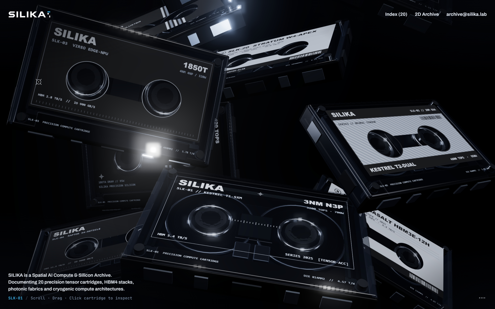
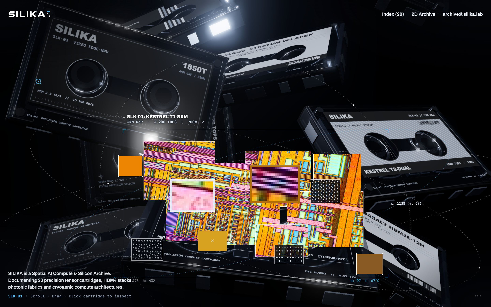
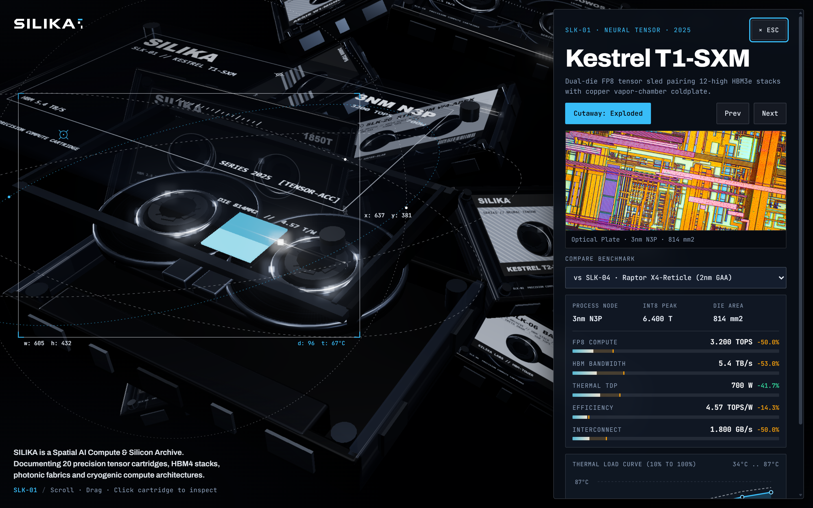

# SILIKA: Spatial AI Compute & Silicon Module Archive

**Live Demo:** [https://silika-vault.vercel.app](https://silika-vault.vercel.app) · **Repository:** [github.com/MrEuwn/silika-vault](https://github.com/MrEuwn/silika-vault)

> **Project Status:** `Speculative` (Awwwards-grade spatial UI/UX portfolio showcase accompanying [Rumah Wiraloka](https://wiraloka-batik.vercel.app)).

SILIKA is a zero-scroll (`100dvh`) monochrome noir spatial archive built for AI infrastructure engineers exploring 20 sculpted silicon compute cartridges across 5 hardware families (`TENSOR-ACC`, `HBM-STACK`, `PHOTON-IO`, `CRYO-TILE`, `WAFER-BLADE`).

## Visual Previews

| Monochrome Spatial 3D Cascade | 2D Retina CV-Tracker + Chroma Mosaic Burst |
| :---: | :---: |
|  |  |



## Architecture & Craft Highlights

- **Spatial WebGL2 Stage (`z: 0`)**: Three.js WebGL2 renderer with procedural darkroom studio softbox `PMREMGenerator` reflections, real `EffectComposer` + `UnrealBloomPass` selective specular halation, and a seamless cyclic vertical cascade of 20 machined transparent acrylic & dark titanium silicon compute cartridges with internal dual rotating concentric wafer platters and 5 bespoke industrial monochrome label graphic treatments.
- **2D Retina CV-Tracker HUD (`z: 1`)**: `Math.min(dpr, 2)` overlay featuring a custom optical crosshair reticle, 4 tilted dashed orbital ellipses with glowing orbital satellites, crisp 1px bounding projection with borderless architectural leader callouts, live pixel coordinates, hatched matrix micro-cells, and an explosive fractured full-color mosaic burst revealing real CC-licensed macro silicon, lithography, photonics, and quantum cryostat photography.
- **Click-to-Inspect Exploded Cutaway & Benchmark Drawer**: Clicking any cartridge frames it heroically in 4-layer exploded cutaway (smoked acrylic lid, heatsink busbars, silicon die core with subtle `#38BDF8` active glow, machined rear chassis) alongside an obsidian-glass data-dense telemetry drawer with interactive peer-to-peer benchmark comparison, inline delta percentage bars, and dual overlaid SVG thermal load curves.
- **Forensic Fixes Over Reference (`bizar.ro`)**:
  - Universal WebGL2 stage with graceful automatic and manual **2D Archive** fallback (no WebGPU dead-end error screen).
  - Invisible 4-corner radial obsidian darkroom vignette scrims keeping corner editorial typography readable even when bright studio bloom passes underneath on desktop and `390px` mobile.
  - Always-visible `Index (20)` navigation trigger plus `:focus-within` keyboard-revealed vertically masked Index Drum.
  - Strictly gesture-gated procedural Web Audio synthesizer with authentic 4-bar bottom-right equalizer.

## Design Tokens

- **Ground**: `#06090F` (Obsidian-Cobalt Void)
- **Drawer Surface**: `#0E1420` / `#141D2D`
- **Ink**: `#E8EEF7` / `#8B9EB8`
- **Active Signal Accent**: `#38BDF8`
- **Typography**: `Archivo` (Display) + `JetBrains Mono` (`tabular-nums` Telemetry)

## Local Development & Verification

```powershell
npm.cmd install
npm.cmd run dev
npm.cmd run build
```

## Photography Attribution

Curated macro silicon wafer, semiconductor die, laser photonics, and cryogenic hardware plates sourced from Wikimedia Commons under CC BY / CC BY-SA / CC0 licenses and stored locally in `public/assets/`.
